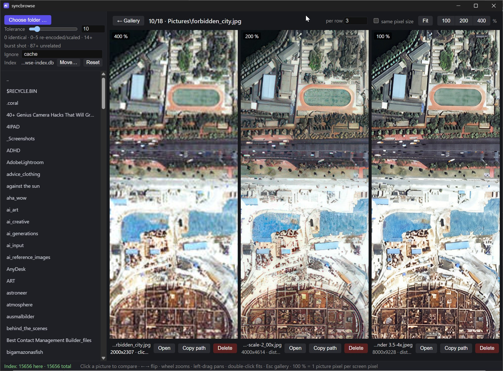

# syncbrowse

Finds the same photo in several versions (upscales, recolors, re-encodes, copies, raw + camera JPEG) by perceptual hash and compares them side by side with synced zoom and pan.



## Download

[syncbrowse.exe](https://github.com/pg0/syncbrowse/releases/latest/download/syncbrowse.exe) for Windows 10/11 (needs the WebView2 runtime, part of Windows 11). The exe is not signed, so SmartScreen may warn: **More info → Run anyway**.

## Build

```
cd rs
cargo build --release
```
